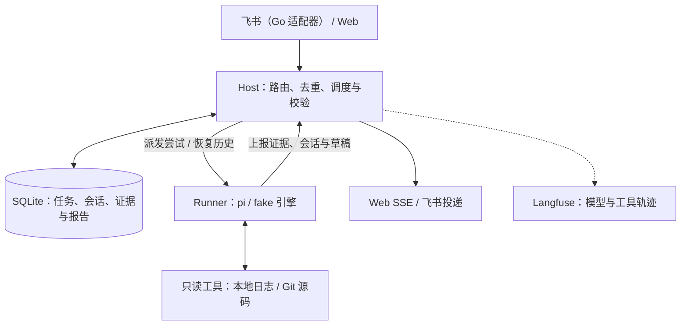

# ticket-doctor

## 项目介绍

ticket-doctor 是面向测试与开发的 **Bug 预诊断 Agent**。提交故障描述后，
Agent 查询日志、检索源码，整理异常线索与根因候选，输出带证据引用的报告，
帮助开发接手排查；材料不足时追问，补充后继续同一调查。

项目聚焦只读取证与预诊断，**关键在于将判断前置，让开发接手时更快定位问题，解决bug更高效**。
最终根因由开发确认。

## 核心功能

### 问题接入与进度查看

支持飞书与 Web 提交问题，自动创建或续接调查；Web 时间线展示消息、执行进度与结果。
Go 适配器已提供多平台接口，钉钉与 Slack 当前为骨架，尚不能接入使用。

### 日志与源码取证

按故障线索查询已配置的本地服务日志，定位源码中的相关文件与代码上下文，
将故障描述与实际材料关联起来。
日志检索受本轮服务与时间窗约束，源码受仓库白名单约束；检索结果提供覆盖信息与续查游标。

### 多轮追问与补证

材料不足时提出具体补充问题。用户继续原调查后，Agent 读取已保存历史，
结合新材料继续排查，证据编号在调查内保持可追溯。

### 带证据的预诊断报告

报告包含事实、根因候选、证据引用、不确定项、缺失材料与下一步，
通过 Web 展示或回写飞书，供开发继续验证。

### 独立审计与有界补证

可开启独立审计会话，逐条检查结论的证据充分性，由程序应用降级判定。
需要补证时，在轮次、工具与总超时预算内返回诊断会话继续取证；审计默认关闭。

### 模型与工具过程复盘

接入 Langfuse，查看捕获到的模型输入输出、工具参数与返回、耗时和 Token 用量，
定位检索、模型调用与报告校验过程中的问题。

### 离线评测与规则改进

已接入 Langfuse 原生数据集、提示词版本、实验与人工复核，并实现 GEPA 的 Python 适配器。
当前仅允许优化外部 `diagnosis_rules`，基础提示词、工具、案例与评分器保持冻结。
真实 GEPA 搜索尚未运行，完整的候选审核、发布与回滚流程仍待补齐。

## 工作原理

推荐采用 **Go 接入适配器 + Host + 独立 Runner** 的单机多进程架构：
Host 管理接入、调度与持久化，每次执行尝试启动一个 Runner，通过 NDJSON 协议交互。



一条消息依次经过 **接收与路由 → 持久化入队 → 领取执行 → 逐步取证 → 校验提交 → 展示或投递**；
用户补充材料后进入下一轮。

### 可靠调度与执行隔离

同一调查按轮次串行，不同调查并行。Host 通过租约、心跳、超时回收与有限重试处理执行中断；
每次领取递增 `generation`，在数据库事务中拒绝旧执行者提交证据和报告。
这类机制参考 [Union 的租约设计](https://www.union.ai/blog-post/inside-union-leases-the-scheduling-engine-behind-flyte-2)
与 [Fencing Token](https://martin.kleppmann.com/2016/02/08/how-to-do-distributed-locking.html)。

### 单库持久化与会话恢复

面向单机部署，选择 SQLite 统一保存业务状态、模型会话与证据，由 Host 集中写入，
避免业务库与会话文件双写不一致。借鉴 pi durable 的恢复思路，
通过 pi SessionManager 重建已保存上下文：已提交证据可用于恢复工具返回，
未决结果标记为未知，已保存的本轮输入不会重复追加。

### 从检索到证据

Runner 准备检索时间窗，并将源码版本解析为固定 Git SHA。本次尝试都检索同一代码快照，
诊断工具不会逐任务 clone 或 pull 仓库；当前来源为本地日志与已有 Git 仓库。

模型按线索调用 `query_logs`、`list_files`、`search_code` 与 `read_code`，
逐步定位问题。工具先提交证据，Host 保存并签发 UID 与调查内 `E#` 后才返回模型。
材料不足时调用 `request_info` 追问，完成诊断时调用 `submit_report` 提交草稿。

### 报告校验、投递与观测

Host 校验引用与报告结构，将报告、执行终态和待发送记录在同一事务提交。
发送失败单独处理，避免投递故障触发重复模型诊断；发送结果无法确认时保留不确定态。

Langfuse 通过 OpenTelemetry 关联调查、执行尝试、模型、工具与报告校验。
观测默认关闭，导出为 best-effort；会话恢复依赖 SQLite，观测失败不阻塞业务提交。

## 快速开始

需要支持 `node:sqlite` 与 `--experimental-strip-types` 的 Node.js，以及 Git。

```bash
npm ci
npm run demo
```

默认 demo 使用 fake 引擎、样例日志和仓库，跑通消息、取证、报告与假投递闭环，
并初始化样例 Git 仓库。若已有 `.env`，检查 `TD_ALLOWED_SERVICES`：
显式空值会拒绝全部日志查询，样例应填写 `checkout-service`。

### 启动 Web 与独立 Runner

复制 [.env.example](.env.example) 为 `.env`，将以下配置写入后运行 `npm run host`：

```dotenv
TD_ENGINE=fake
TD_RUNNER_MODE=process
TD_FEISHU_DIRECT=false
TD_REPOS=app:./fixtures/demo-repo
TD_ALLOWED_SERVICES=checkout-service
```

打开 `http://localhost:3000/`。调用真实模型需设置 `TD_ENGINE=pi` 与对应提供商凭据；
使用实际材料时替换仓库、日志目录与服务白名单。

飞书接入见 [Go 适配器说明](adapters/go/README.md)：单独运行 Go 时需要注入环境变量，
它不会自动读取根目录 `.env`。也可使用 [Docker Compose](docker-compose.yml)，
将 `.env` 中 `TD_DB_PATH` 改为 `/data/ticket-doctor.sqlite`，使数据库保存在持久卷中；
填写 Go 适配器使用的 `LARK_*` 凭据，并按需替换源码与日志挂载。

### 工程检查

```bash
npm test
npm run typecheck
npm run docs:check
npm run test:go
```

Go 检查需要 Go 环境。Langfuse 的启用、部署与验收见 [观测手册](docs/self-host-langfuse-runbook.md)。

## 当前状态

开发当前暂停，进度与本机核验结果见 [状态源](docs/status.json#development) 和
[自改进状态](docs/status.json#self_improvement)。恢复入口见 [最新会话交接](docs/session-handover.md) 与
[自改进交接](docs/self-improvement-handover.md)。

| 能力 | 状态 |
|---|---|
| 接入、调度、恢复、取证、报告与投递 | 工程闭环已实现；运行前需恢复本地依赖与样例产物 |
| 真实模型与 Langfuse | 官方 tracing SDK 迁移与原生离线评测第一阶段已完成，已有历史实验记录 |
| 检索来源 | 本地文件日志与 Git；远程日志、生产诊断 MCP 与仓库同步器待建设 |
| 质量评测与独立审计 | 离线评测、独立审计与有界补证已实现；语义人工复核、裁判校准与质量 CI 门禁待完善 |
| RSI 改进闭环 | 材料准入、固定评测桥梁、冻结基线与配置、C 适配器已实现；真实搜索、D 完整审核发布与独立验收待完成 |
| 接入与访问控制 | 飞书长连接待真机验收；Web 无登录与权限体系；钉钉/Slack 为骨架，图片未接入 |

程序校验引用有效性不等于确认根因。旧 v1/v2 评测已移除，现有 `src/eval/` 与 `src/evolve/` 是后续实现。
自改进冻结基线来自公开模拟材料上的真实 pi 调用，不代表真实生产质量；工程 demo 与样例观测也不等同于生产诊断验收。
历史测试通过记录不代表本轮环境已通过，线上服务状态需恢复时另行检查。

<details>
<summary>检索与运行的当前边界</summary>

- `query_logs` 已校验本轮服务范围并收窄时间窗；日志接口仍缺环境与 request-id 结构化过滤字段。
- `TD_ALLOWED_REPOS` 已作为硬白名单，在配置解析与诊断准备两层过滤源码仓库。
- 材料源已提供总数、截断、剩余结果与续查游标，空结果会与失败、越权分开呈现。
- `TD_MAX_MODEL_TURNS` 已解析配置并传入引擎选项，但模型循环尚未强制执行该上限，恢复开发时需与请求前预算控制一起补齐。
- SHA 在每次尝试准备时解析，同轮重试的固定版本机制尚未补齐；按发生时间选提交不等于确认部署版本。
- Langfuse 观测可能截断或丢失，统一脱敏尚未实现；会话恢复以已保存内容为准。
- 自改进预算目前为 `monitor`，在 trial 间累计停止；请求前硬拦截仍需统一 gateway。holdout 只在候选固定后独立验收。

</details>

## 目录指引

```text
src/                 业务源码：Host/Runner、诊断、工具、证据、存储、观测、评测与自改进桥梁
adapters/go/         飞书接入与投递适配器；钉钉/Slack 骨架
tools/evolve/        Python GEPA 适配器、反射模型客户端与搜索入口
scripts/             演示初始化、评测/自改进命令、环境与迁移脚本
evolve/              冻结搜索配置与案例复核记录
fixtures/            演示/评测材料与公开模拟故障原始材料
migrations/          SQLite 迁移
tests/               TypeScript 单元与集成测试（Go/Python 测试在各自目录）
deploy/              Langfuse 与 systemd 部署资产
docs/                文档索引、交接、开发清单与专项方案
data/                本地产生的数据库、派生案例和实验产物，不由 Git 保存
```

文件级导航见 [开发上手指南](docs/contributor-onboarding.md)，文档入口见 [文档索引](docs/README.md)。

## 详细文档

- 暂停与恢复：[最新交接](docs/session-handover.md)、[自改进交接](docs/self-improvement-handover.md)、[资源迁移](docs/deployment-inventory.md)。
- 使用与接入：[产品使用](docs/usage.md)、[Go 适配器](adapters/go/README.md)。
- 架构与接口：[Host/Runner](docs/host-runner-design.md)、[接口协议](docs/interface.md)、[并发设计](docs/concurrency.md)。
- 会话与证据：[会话持久化](docs/session-log-design.md)、[证据 UID 与恢复](docs/evidence-uid-design.md)、[材料范围](docs/evidence-scope-design.md)。
- 观测与评测：[Langfuse 手册](docs/self-host-langfuse-runbook.md)、[原生评测](docs/langfuse-eval-implementation-plan.md)、[SDK 迁移](docs/langfuse-sdk-migration.md)。
- 自改进：[实施方案](docs/self-improvement-implementation-plan.md)、[冻结基线](docs/self-improvement-baseline.md)、[GEPA 适配器](tools/evolve/README.md)。
- 开发清单：[路线图](docs/roadmap.md)、[待办清单](docs/backlog.md)、[代码导航](docs/contributor-onboarding.md)、[功能状态](docs/status.json)。

完整目录见 [文档索引](docs/README.md)。时点设计中的历史路径、命令与状态需要结合当前代码和状态源核对。
